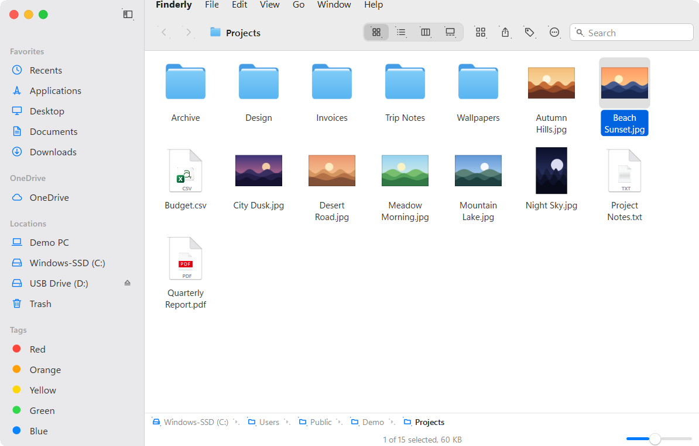
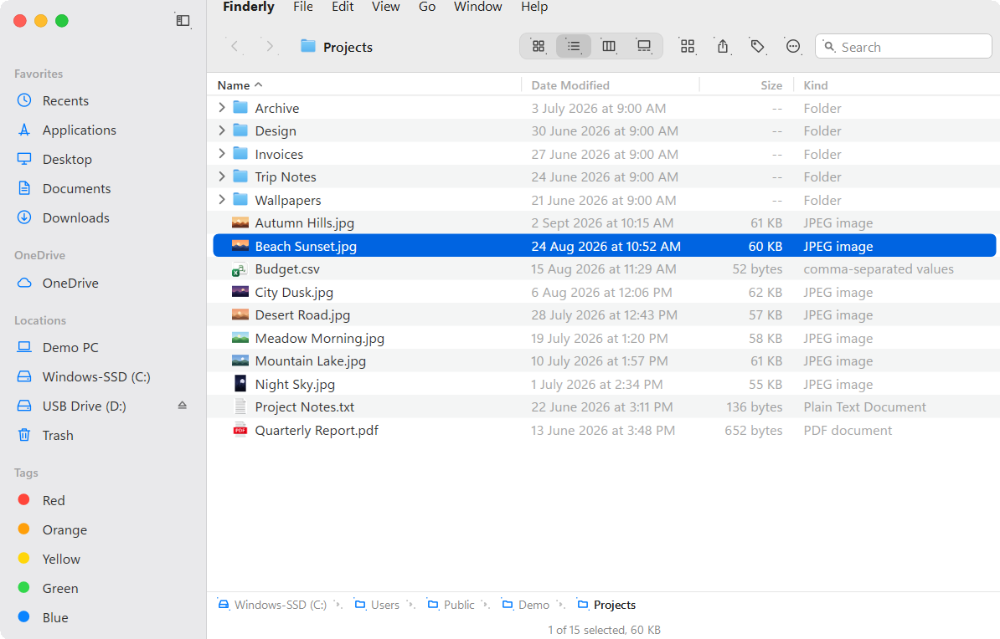
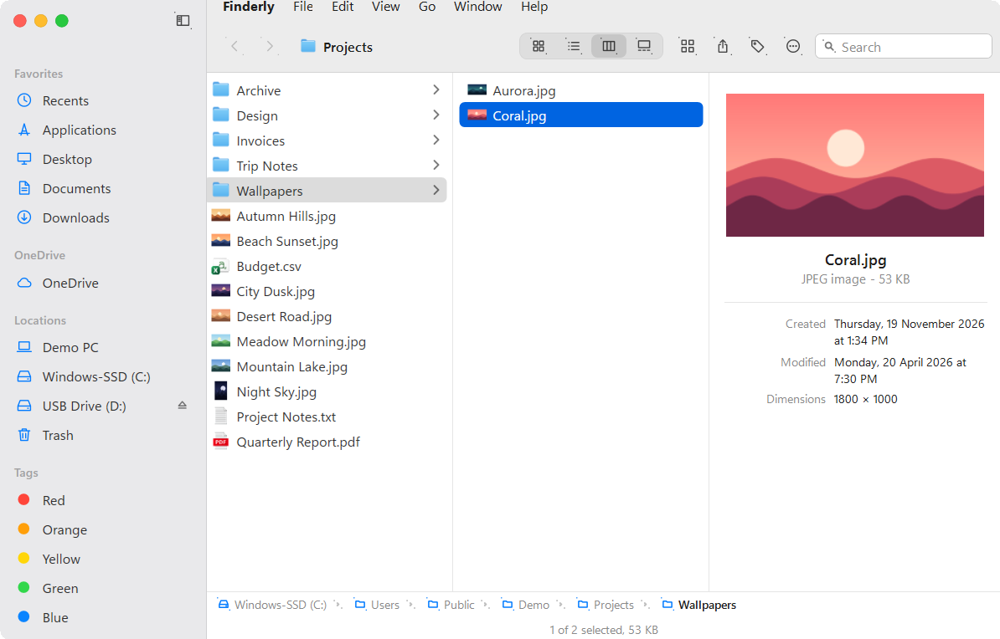
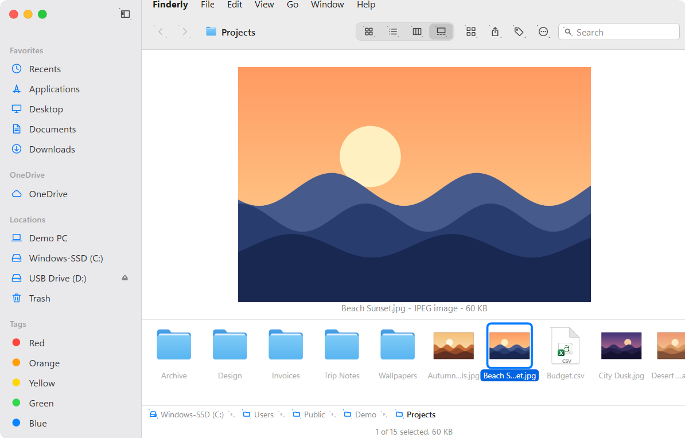
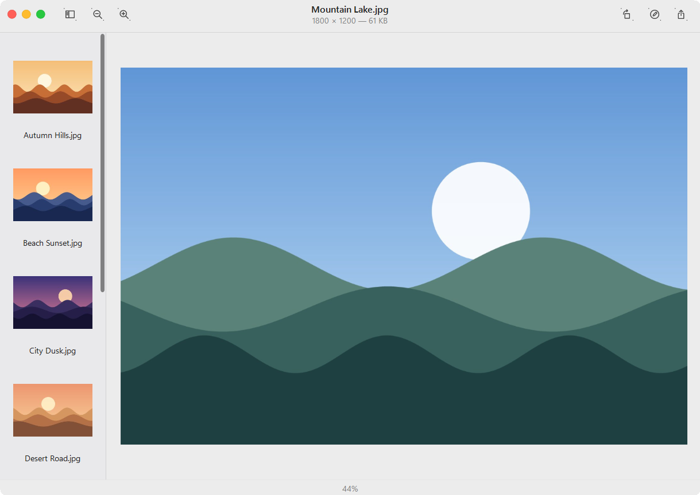
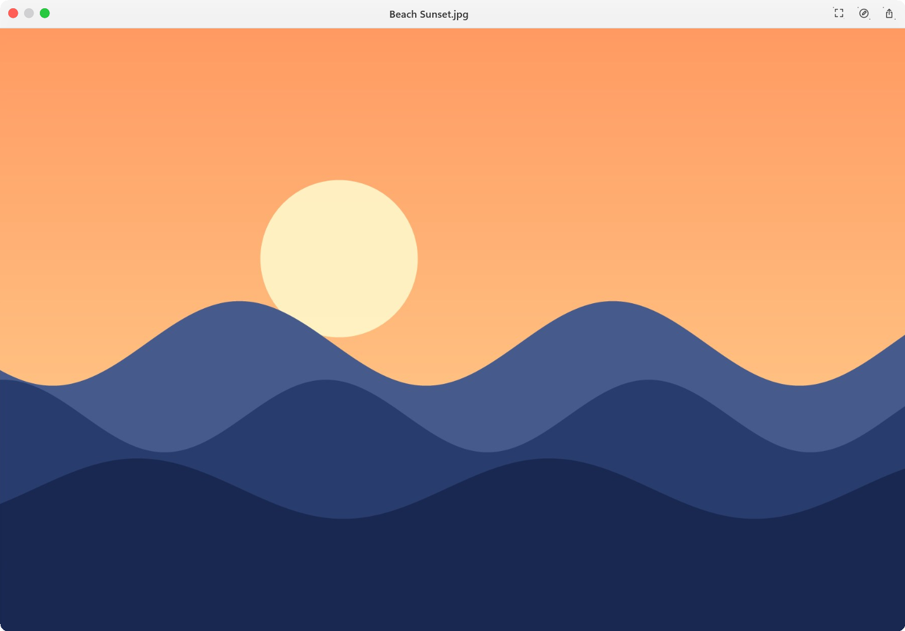

<p align="center"></p>

# Finderly

**Finderly - a Finder-style file manager and Preview-style image/PDF viewer for Windows.** It brings the Mac Finder layout to Windows: traffic-light window buttons, a sidebar with Favorites and Tags, Icon / List / Column / Gallery views, tabs, a path bar, and Quick Look on the Space bar. Everything is drawn by hand and virtualized, so big folders stay snappy.



> Made with [Claude](https://claude.com/claude-code) (Anthropic). See [Contributors](#contributors).

## What it does

| | |
|---|---|
| **Four views** | Icon, List, Column and Gallery, switched with `Ctrl+1` to `Ctrl+4`. Column view shows a preview with details for the selected file. |
| **Quick Look** | Press `Space` to preview a file. The window zooms out of the file's icon, and the arrow keys step through the folder. |
| **Preview viewer** | Opens images and PDFs with a thumbnail sidebar, zoom, rotate and markup tools. |
| **Tabs and windows** | `Ctrl+T` for a new tab, `Ctrl+N` for a new window, with a Mac-style tab bar. |
| **File operations** | Copy, move, rename, duplicate, aliases, compress, Trash and full undo / redo. Drag and drop works, including spring-loaded folders. |
| **Search, tags, sorting** | Searches the Windows index, colour tags, grouping and sorting, plus per-folder view settings. |
| **Dark mode** | Follows the Windows light / dark setting. |

<p align="center">
  
  
</p>
<p align="center">
  
  
</p>
<p align="center"></p>

*(Screenshots use demo files and a generic computer name.)*

## Install

1. Download **Finderly-Setup.exe** from the [Releases](../../releases) page and run it (no admin rights needed).
2. Launch **Finderly** from the Start menu. In the installer you can also tick **Open with Finderly** for folders and **Open with Preview** for images and PDFs.

The installer includes the .NET runtime, so nothing else is needed. Windows may show a SmartScreen warning because the installer is unsigned - choose *More info -> Run anyway*.

## Using it

| Action | Keys |
|---|---|
| Quick Look the selected file | `Space` |
| Icon / List / Column / Gallery view | `Ctrl+1` / `2` / `3` / `4` |
| New tab / new window / new folder | `Ctrl+T` / `Ctrl+N` / `Ctrl+Shift+N` |
| Back / forward / enclosing folder | `Ctrl+[` / `Ctrl+]` / `Ctrl+Up` |
| Get Info | `Ctrl+I` |
| Rename | `F2` |
| Duplicate | `Ctrl+D` |
| Move to Trash | `Ctrl+Backspace` |
| Undo / redo | `Ctrl+Z` / `Ctrl+Y` |
| View options | `Ctrl+J` |
| Go to folder | `Ctrl+Shift+G` |

Type a few letters to jump to a file. Right-click for the context menu, and use the menu bar for everything else. Settings are stored in `%APPDATA%\Finderly\settings.json`.

## How it works

- **Drawing** - every file view is a custom WPF element that only draws the rows or icons on screen, with its own smooth scrolling, rubber-band selection and inline rename.
- **Thumbnails** - loaded in the background through the Windows shell, cached, and loaded in the order you scroll to them.
- **Preview** - images are decoded at screen size; PDFs use the Windows PDF renderer.
- **Privacy** - it only reads and changes the files you work with. There is no network code and no telemetry.

### Limitations

- It is inspired by the Mac Finder and Preview, not a pixel-exact copy. The name and icons are original.
- Rendering is in software by default because hardware rendering showed a blank window on some machines. Start with `--gpu` to try hardware rendering.

## Build from source

```powershell
dotnet run                                                      # run it
dotnet publish -c Release -r win-x64 --self-contained true -o publish
```

The installer is an [Inno Setup](https://jrsoftware.org/isinfo.php) script, `Finderly.iss`. Publish first, then compile it with Inno Setup 6. Compile from a short folder path if you hit long-path errors.

## Contributors

- **Claude** (Anthropic) - designed and wrote the code in this repository, working with the repo owner.
- **[eetan-J](https://github.com/eetan-J)** - idea, direction, testing and feedback.

## License

MIT - see [LICENSE](LICENSE).
